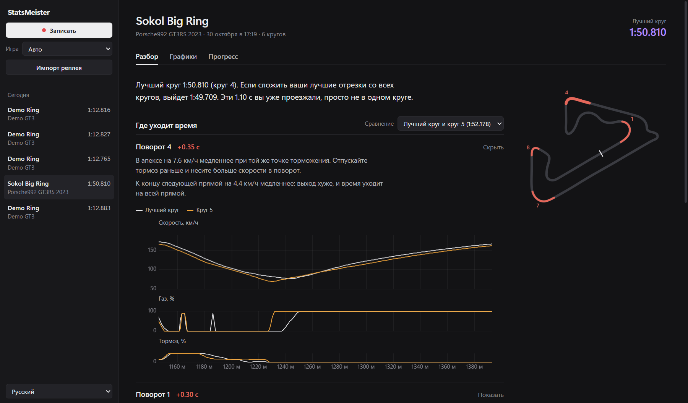

<div align="center">

# StatsMeister

**Бесплатная телеметрия для симрейсинга с открытым кодом.**

Записывает круги, накладывает их друг на друга по дистанции и показывает, в каком повороте теряется время и почему.

[](LICENSE)


</div>



## Зачем

MoTeC i2 умеет почти всё, но сделан для инженеров: чтобы найти, где ты проиграл полсекунды, надо полчаса крутить графики. StatsMeister я пишу для тех, кто катает каждый день и хочет понемногу ехать быстрее. Открываешь сессию, и программа сама показывает, куда ушло время: затормозил позже, а апекс прошёл медленнее, или газ открыл на 20 метров позже, чем на лучшем круге.

## Что умеет

- Пишет телеметрию прямо во время езды из Assetto Corsa и ACC через shared memory: около 333 раз в секунду, примерно 70 каналов. Там педали, скорость, перегрузки, температура, давление и износ шин, температура тормозов, подвеска, проскальзывание и нагрузка на каждое колесо, позиция на трассе.
- Импортирует реплеи Assetto Corsa (`.acreplay`). Перетащил файл на окно, и старые заезды можно разбирать так же, как новые.
- Сам находит круги и берёт время круга из игры. Выезд, круги с заездом в пит и срезки помечаются.
- Сравнивает любые два круга, даже из разных сессий. Круги выравниваются по положению на трассе, а не по времени, поэтому одинаковые повороты совпадают на графике. Сверху идёт дельта: сколько круг B проигрывает кругу A в каждой точке.
- Разбирает круг по поворотам. Повороты находятся автоматически, и для каждого видно, сколько времени потеряно или выиграно, минимальную скорость, где началось торможение и где открыт полный газ. Клик по повороту приближает все графики к нему.
- Рисует карту трассы: зелёным участки, где круг B быстрее, красным, где медленнее.
- Показывает графики скорости, газа, тормоза, руля, передачи, оборотов и боковой перегрузки. Курсор и зум у них общие, рядом значения в точке курсора и статистика кругов.
- Хранит данные в открытом формате (Parquet + JSON), любой круг или сессию можно выгрузить в CSV.
- Работает из командной строки: запись, импорт, сравнение и экспорт без интерфейса.
- Есть демо-режим с виртуальной машиной на выдуманной трассе, чтобы попробовать всё без игры.

## Какие игры поддерживаются

| Игра | Запись во время езды | Импорт файлов |
|---|---|---|
| Assetto Corsa | ✅ shared memory | ✅ `.acreplay` (формат v16) |
| Assetto Corsa Competizione | ✅ shared memory | нет |
| iRacing | в планах | в планах (`.ibt`) |
| Automobilista 2 | в планах | нет |
| Le Mans Ultimate / rFactor 2 | в планах | нет |

В реплеях меньше данных, чем при живой записи. Нет температуры и давления шин, топлива, срабатываний ABS и TC, информации о срезках, а частота ограничена качеством реплея: при стандартных настройках около 33 кадров в секунду. Тренировки лучше записывать вживую, а импорт оставить для старых заездов.

## Установка и запуск

Понадобятся:

- Windows 10 или 11 (WebView2 там уже есть);
- [Rust](https://rustup.rs), стабильная версия с тулчейном MSVC, и Visual Studio Build Tools;
- [Node.js](https://nodejs.org) 20 или новее.

Если сборка падает, проверьте [требования Tauri](https://v2.tauri.app/start/prerequisites/).

```bash
git clone https://github.com/Voidhmslf/StatsMeister.git
cd StatsMeister/app
npm install
npm run tauri dev
```

Установщик собирается командой `npm run tauri build`, готовый файл появится в `target/release/bundle`.

## Как пользоваться

1. Запись. Выберите «Auto-detect» или конкретную игру, нажмите Record и езжайте. Каждый выезд на трассу сохраняется отдельной сессией, круги появляются в списке по мере прохождения.
2. Импорт. Нажмите Import или перетащите `.acreplay` на окно. AC хранит реплеи в `Documents\Assetto Corsa\replay`. Поставьте в настройках игры максимальное качество реплеев, тогда данных будет больше.
3. Разбор. Лучший круг сразу выбирается как A, а как B берётся последний круг, который не хуже лучшего больше чем на 3 %. Смотрите таблицу поворотов сверху вниз. Кликните поворот, где теряется больше всего, и на графиках будет видно, что пошло не так: торможение, скорость в апексе или газ на выходе.

Игры под рукой нет? Выберите Demo и нажмите Record.

## Командная строка

```bash
cargo run -p sm-cli -- --help
```

```bash
statsmeister record                          # найдёт запущенную игру, остановка по Ctrl+C
statsmeister record --source demo --fast --laps 5
statsmeister import "sokol hotlap.acreplay"
statsmeister list
statsmeister laps latest
statsmeister compare latest:best latest:3    # разбор по поворотам
statsmeister export latest --lap 3 -o lap3.csv
```

Так выглядит вывод `compare` на реальном реплее:

```text
A = lap 4 1:50.810   B = lap 5 1:52.178   track ≈ 4376 m
Corner   apex  B vs A   min speed A/B    brake point B vs A   full throttle B vs A
T1      364 m  +0.301   100.5 /  98.0       7 m later            6 m later
T4     1243 m  +0.347    77.2 /  69.6    same                    6 m earlier
T9     3719 m  -0.161    75.6 /  82.9    same                    3 m earlier
...
```

В T1 круг B тормозит на 7 метров позже, но проходит апекс медленнее и позже открывает газ. Позднее торможение тут не окупилось.

## Где лежат данные

Сессии сохраняются в `%APPDATA%\StatsMeister\data\sessions\<id сессии>\`. Путь можно поменять переменной окружения `STATSMEISTER_DATA`.

```text
meta.json           описание сессии, список каналов, круги со временем и пометками
telemetry.parquet   колонка "t" (секунды) и по колонке на каждый канал, сжатие zstd
```

Parquet открывается в DuckDB, pandas, Polars и вообще в чём угодно, что его читает. Общие каналы называются одинаково для всех игр и пишутся в одних единицах: `speed` в км/ч, `throttle` от 0 до 1, `lap_dist_pct` от 0 до 1 и так далее, полный список в [`ch.rs`](crates/sm-core/src/ch.rs). Каналы, которые есть только в конкретной игре, тоже сохраняются.

## Устройство проекта

```text
crates/
  sm-core       модель данных: каналы, кадры, трейт TelemetrySource
  sm-sources    адаптеры игр: ac/ (shared memory AC и ACC, импорт .acreplay), демо, автоопределение
  sm-storage    папки сессий (Parquet + JSON), экспорт в CSV
  sm-recorder   цикл записи и разбивка на круги
  sm-analysis   выравнивание и сравнение кругов, поиск поворотов, статистика
  sm-cli        консольная утилита statsmeister
app/
  src/          интерфейс: TypeScript, Vite, uPlot
  src-tauri/    оболочка на Tauri 2, через неё интерфейс вызывает крейты
docs/
  ROADMAP.md    планы
```

## Разработка

```bash
cargo test --workspace
cargo clippy --workspace --all-targets
cargo fmt --all
```

Проверить парсер на своём реплее:

```bash
STATSMEISTER_TEST_REPLAY="path/to/file.acreplay" cargo test -p sm-sources
```

### Как добавить игру

Реализуйте `sm_core::TelemetrySource` в новом модуле внутри `crates/sm-sources`, переведите значения игры в стандартные каналы и добавьте источник в `SourceKind` и `KNOWN_GAMES`. Запись, хранение, анализ и интерфейс трогать не придётся.

## Что дальше

Подробно в [docs/ROADMAP.md](docs/ROADMAP.md), коротко:

- iRacing (живая запись и импорт `.ibt`), Automobilista 2, Le Mans Ultimate и rFactor 2;
- теоретически лучший круг и стабильность по каждому повороту на всех кругах;
- прогресс по дням для каждой пары трасса + машина;
- экспорт в формат MoTeC i2 (`.ld`);
- AI-тренер на локальной модели (Ollama, LM Studio) или облачной, который объясняет разбор по поворотам человеческим языком.

## Как помочь

Issues и pull request'ы приветствуются. Перед PR прогоните тесты, clippy и rustfmt. Форматы, разобранные вручную (как `.acreplay`), описаны прямо в модуле, который их читает. Если у вас реплей, на котором парсер ошибается, присылайте: это сильно помогает.

## Лицензия

[MIT](LICENSE)
